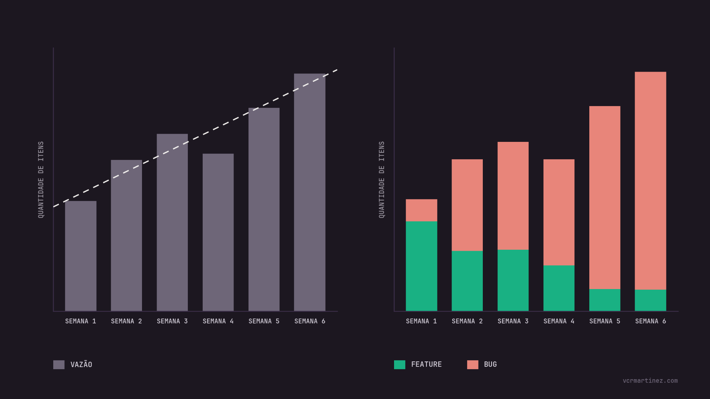

## Throughput
Vazão do time. Procure por consistência! A regularidade lhe dá previsibilidade.

Uma boa prática é segmentar por tipo de demanda ou classe de serviço.

![Gráfico de barras com a quantidade de itens entregues por semana ao longo de 20 semanas. Os valores semanais, da semana 1 à 20, são: 6, 8, 7, 10, 5, 4, 8, 7, 9, 6, 7, 6, 6, 10, 5, 7, 9, 6, 8 e 7. O mínimo foi 4 itens (semana 6) e o máximo 10 (semanas 4 e 14). Três linhas horizontais marcam os percentis de entrega: em 60% das semanas foram entregues 7 ou mais itens, em 85% foram 6 ou mais e em 95% foram 5 ou mais. Uma linha de tendência pontilhada mostra leve alta ao longo do período, saindo de cerca de 7 itens.](./throughput-run-chart.png)

Uma boa prática é segmentar por **tipo de demanda** ou **Classe de Serviço**.

Boa prática: a **Carga de Falha** nos dá indícios do nível da qualidade das entregas anteriores e do retrabalho dentro do nosso sistema.

> Esse indicador responde a seguinte pergunta: nossas entregas trazem retorno ao negócio ou apenas aumentam nosso custo operacional?

![Gráfico de barras empilhadas com a quantidade de itens entregues em seis semanas, divididos entre Feature (verde) e Bug (vermelho claro). Sobre cada barra aparece o percentual de bugs na entrega da semana: 20% na semana 1, 42% na semana 2, 62% na semana 3, 71% na semana 4, 89% na semana 5 e 91% na semana 6, este último destacado por um círculo. O volume total cresce ao longo do período, mas a parcela de features encolhe até virar uma faixa estreita na base, enquanto os bugs passam a dominar quase toda a entrega.](./percentual-bugs-semana.png)

O cálculo é simples: defeitos / throughput. Por exemplo, assumindo a vazão de 11 cards na semana 6 sendo 10 deles do tipo bug, então temos 91% de carga de falha.

## Lead Time

## Work in Progress
